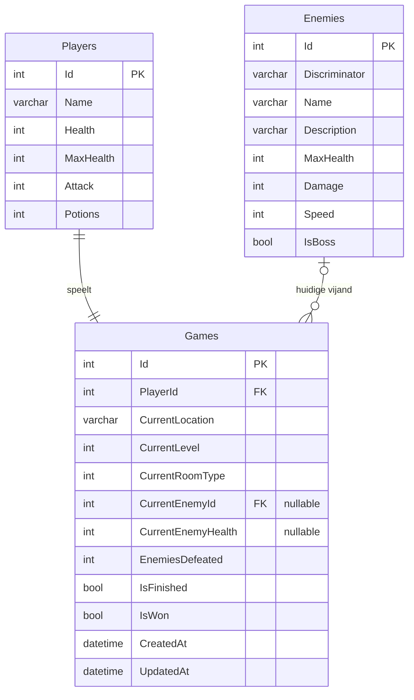

# Relaties tussen de tabellen

- Ieder spel heeft precies één speler (`Games.PlayerId`, verplicht).
- Een spel kan een huidige vijand hebben (`Games.CurrentEnemyId`, optioneel). Dezelfde vijand-rij wordt door alle spellen gedeeld; de actuele HP van de vijand in dit spel staat in `Games.CurrentEnemyHealth`.
- `Enemies` gebruikt Table Per Hierarchy: alle subclasses in één tabel, met een kolom `Discriminator`.

**Waarom deze velden in de response?** Om een spel te hervatten heeft de console nodig: het id (voor volgende requests), level, locatie en soort ruimte, de stats van de speler, de huidige vijand met zijn actuele HP, en of het spel afgelopen of gewonnen is. `CreatedAt`, `PlayerId` en `Discriminator` stuurt de API niet mee, want de console heeft ze niet nodig.
