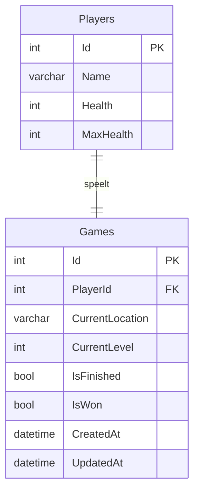

# Relatie Player en Game (week 4)

Een speler hoort bij één spel; ieder spel heeft precies één speler (verplicht, via `PlayerId`).

**Waarom deze velden in de response?** Om een spel te hervatten heeft de console nodig: het id (om volgende requests te sturen), level en locatie (waar sta je), de levens van de speler en of het spel afgelopen of gewonnen is. `CreatedAt` en `PlayerId` stuurt de API niet mee, want de console heeft ze niet nodig.
